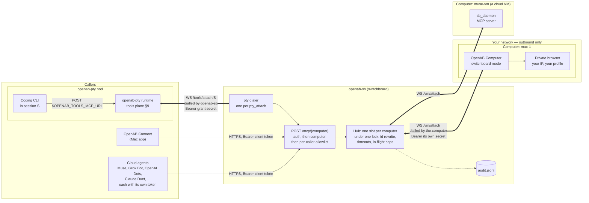
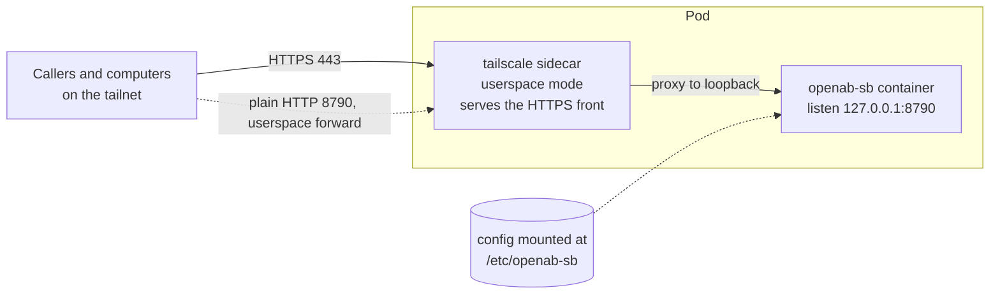
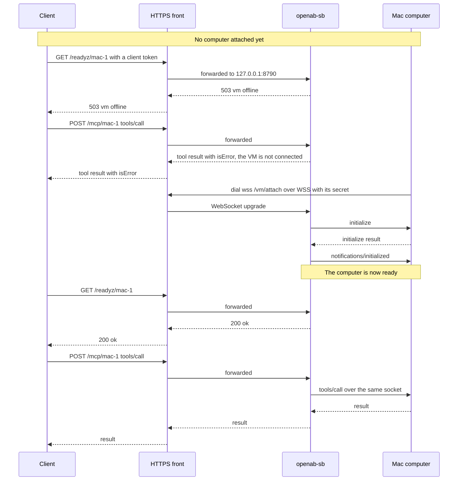
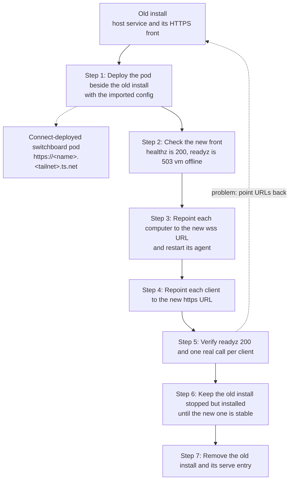

# openab-sb — OpenAB Switchboard

A generic switchboard that lets agents use tools on **computers you own that can only dial
out** — most usefully, **the browser on a machine in your own network instead of a cloud VM's**.

Callers can be an `openab-pty` session, OpenAB Connect, or any agent that can call a remote MCP
server with a bearer token (Muse, Grok Bot, OpenAI Dots, Claude Duet, …; see
[Callers](#callers)). Each computer dials the switchboard over one WebSocket and serves MCP on it.
The switchboard relays calls down that socket and sends the results back. It does not run tools and
it does not store anything.

One switchboard serves **many computers**: one port, one `tailscale serve` entry, one
approved address, and one endpoint per computer. Callers are granted access per computer,
deny by default.



Thick links are WebSockets, and each label says which side dials. Calls always flow from
the callers toward a computer: a computer dials in and then serves MCP on its own socket,
and the switchboard dials the pod and then answers the pod's requests on that socket. TLS
comes from whatever fronts the switchboard (`tailscale serve`, a Tailscale sidecar in a pod, or `cloudflared`; see Run).

## Use your own browser, not the cloud VM's

An agent's built-in browser runs in the vendor's environment: it shows that environment's network
address and holds none of your logins. A computer in your own network has your address (for
example your home ISP) and your browser profile, but it sits behind NAT and cannot be reached from
the cloud. The switchboard bridges the two without opening an inbound port: the computer dials out,
the agent calls in, and the switchboard relays between them. The per-caller allowlist decides which
tools each agent may use, for example the browser tools only.

A worked example, with a Mac mini at home, Muse as the caller, the switchboard on a separate
tailnet host, a diagram and the results of the proof of concept, is in
[`docs/reference-architecture-muse-home-browser.md`](docs/reference-architecture-muse-home-browser.md).

**Read the trust note first.** A browser tool call runs in the computer's browser profile, with its
cookies and signed-in sessions. Use a dedicated profile that is signed in only to what the task
needs, not your daily one (see [Trust](#trust)).

## Callers

| Caller | How it connects | Status |
|---|---|---|
| `openab-pty` session | the switchboard dials the pod's `/tools/attach/{session}` (`[[pty_attach]]`); the CLI keeps using `$OPENAB_TOOLS_MCP_URL` | in this README and covered by the e2e tests against a fake pod |
| OpenAB Connect | `https://<switchboard>/mcp/<computer>` with a client token | described below |
| Muse | remote MCP through its custom connector, with a bearer token | proof of concept run end to end on 2026-10-26, see the reference architecture |
| Grok Bot, OpenAI Dots, Claude Duet | any client that can call a remote MCP server with a bearer header | **not tested**; whether each can add such a server has not been checked |

A caller needs only three things: an HTTPS route to the switchboard, a client token, and an MCP
client that can send `Authorization: Bearer`. How a given agent reaches the switchboard (a tailnet
proxy, a public front) depends on that agent's own network rules.

## How it fits

- **Southbound (computer → switchboard):** the computer dials `GET /vm/attach` with a bearer
  secret, and **the secret alone selects which computer it is**. The URL does not change, so
  any v1 daemon works as is. The frames are plain MCP JSON-RPC, with no custom envelope, so
  any MCP server becomes a switchboard backend by dialling out instead of listening. The
  contract is in [`docs/SOUTHBOUND-CONTRACT.md`](docs/SOUTHBOUND-CONTRACT.md), and a reference
  daemon is in [`examples/muse-daemon/`](examples/muse-daemon/sb_daemon.py).
- **Northbound for Connect:** add a computer in Connect with URL
  `https://<switchboard>/mcp/<computer>` and a client token — one entry per computer, which is
  how MCP clients already hold several servers. `https://<switchboard>/mcp` is the caller's
  `default_computer` and never changes meaning when a computer is added. Connect calls
  `sys_info` and `screenshot`. While a computer is offline, Connect still finds the switchboard
  (`/healthz` is 200) and shows the tool error "the VM is not connected" rather than
  "unreachable". `GET /readyz/<computer>` is the per-computer probe for monitoring.
- **Northbound for PTY:** this needs no change to openab-pty. The switchboard plays the
  "Mac" in openab-pty's tools plane (`CLIENT-CONTRACT.md` §9). It dials the pod's
  `/tools/attach/{session}` and serves the tools of the one computer named in that
  `[[pty_attach]]`, so the CLI in that session reaches them through its usual
  `$OPENAB_TOOLS_MCP_URL`. An agent that can reach the switchboard directly can also use
  `POST /mcp/<computer>` with its own token.
- **Pickers** (OpenAB Computer's hands-node registry, Connect) read `GET /computers`. There is no
  `list_computers` MCP tool: a model already on `/mcp/<computer>` could not act on such a list.

## Config

```toml
max_inflight = 8               # default for every computer

[[computer]]
name = "mac-1"               # 1-64 chars of [A-Za-z0-9_-]; no `.`
secret_sha256 = "sha256:…"     # the identity. The name is just a label

[[computer]]
name = "muse-vm"
secret_sha256 = "sha256:…"
max_inflight = 4               # optional override

[[client]]
name = "muse"
token_sha256 = "sha256:…"
computers = { mac-1 = ["sys_info", "screenshot"] }   # deny by default
max_inflight = 4               # this caller's share of one computer

[[client]]
name = "owner"
token_sha256 = "sha256:…"
default_computer = "mac-1"                           # what bare /mcp means
computers = { "*" = ["*"] }    # owner: every computer, including ones added later

[[pty_attach]]
name = "kiro-1040"
computer = "muse-vm"           # required when more than one is configured
url = "wss://…/tools/attach/laptop"
secret_file = "…"
tools = ["*"]
```

| Rule | |
|---|---|
| identity | the verifier. Whoever holds a computer's secret answers as that computer, so a leaked secret is replaced, not tolerated. Anything a computer reports about itself (`serverInfo`, hostname, forwarded headers) is shown, never trusted |
| names | computers are `[A-Za-z0-9_-]`, 1-64 chars. `.` is refused, because a bare TOML key such as `host.local` is a dotted key. Client and pty-attach names keep `.`, and they are a separate namespace from computer names (audit lines carry `principal` and `computer` separately) |
| verifiers | unique across every computer and every client |
| access | `computers` may not be empty; a computer missing from it does not exist for that caller, on every route. `"*"` may not be mixed with names |
| `default_computer` | required for a `"*"` caller and for anyone who names more than one computer; optional (and implied) when exactly one is reachable. It must be a computer that caller may reach |
| every name must exist | in `default_computer`, in a `computers` table or in `[[pty_attach]].computer`. Otherwise a typo such as `macmni` would grant nothing today and pre-grant access to whatever takes that name later. So removing a computer fails the reload until every block naming it is edited in the same change |
| caps | `max_inflight` is 1..=64 everywhere it appears |
| v1 | `[vm]` still loads as a computer named `default`; a client's `tools = [...]` becomes `computers = { default = [...] }`; a `[[pty_attach]]` without `computer` targets it. `[vm]` together with `[[computer]]`, or `tools` together with `[[computer]]`, is an error |

`openab-sb check` applies all of this and warns about any computer no client or pty attach
may use.

## Behaviour

| | |
|---|---|
| computers | one live socket each, selected by the presented secret. A newer attach with the *same* secret replaces the older one (`4002`), and the older socket's cleanup never touches the newer one or another computer. A computer that fails the MCP handshake is closed with `4005` |
| isolation | one lock over the whole table, but a pending table, `max_inflight`, ping liveness, close handling and `generation` per computer. A slow or dead computer cannot starve another |
| ids | rewritten per call, so callers sharing one socket cannot collide |
| methods | `initialize` and `ping` are answered locally (`initialize` names the computer in its instructions), `tools/list` is filtered, `tools/call` is policed. Everything else gets `-32601` and is not forwarded |
| policy | resolved once per request, from the path, before any frame is sent: the token, then the computer, then the tool. `vm_status` is always available and carries a `computer` field |
| limits | per computer `max_inflight` (default 8), plus a per-caller share of it — `[[client]].max_inflight` / `[[pty_attach]].max_inflight`, default half the live socket's limit rounded up — so one caller cannot occupy a shared computer. Per-tool timeouts (`screenshot` 10 s, default 60 s); 16 MiB frames from a computer |
| failures | `-32001` computer offline (returned as a tool error so clients keep the server), `-32002` over a cap, `-32003` timed out, `-32004` disconnected mid-call. Nothing is retried |
| state | memory only. A restart fails every in-flight call |
| audit | JSON lines, file mode `0600`: attach, detach, takeover, rename, auth failures (capped at 20 a minute, the rest summarised), and every `tools/call` with caller, computer, tool, outcome, latency, size, and (optionally) arguments with secret-bearing ones redacted (see [Audit redaction](#audit-redaction)). Results and error messages are never logged, only their size and JSON-RPC code |
| PTY attach | redials with backoff on drops, on `4006` (pod replaced) and on proxy errors such as `502`; a `401`/`403`/`429` refusal waits a minute for a fresh grant; stops on every other `4xxx`, per openab-pty §9.2. At most 64 requests from one pod are handled at once, and the attach's own `max_inflight` applies on top |

### Reload (`SIGHUP`)

| Change | Effect |
|---|---|
| Client added, removed, token rotated, allowlist or `default_computer` changed | from the next request |
| Computer added | its slot exists at once and accepts an attach |
| Computer removed, or its verifier rotated | that socket closes with `4003`. Its in-flight calls fail with `-32004` and **may have run**. Other computers are untouched |
| Same verifier, new name (including a verifier moved between two names) | the live socket is relabelled, an audit line `computer_renamed` records it, and nothing closes |
| `max_inflight`, global or per computer | reloaded, and applied to that computer's next attach. A live socket keeps the value it attached with |
| Per-caller `max_inflight` | from that caller's next call |
| A `[[pty_attach]]`'s `computer`, `tools` or `max_inflight` | swapped on the running attach, from its next request, so a renamed computer keeps serving that pod |
| `[[pty_attach]].allow_insecure_transport` | takes effect only at startup. A reload reads it only to validate the `url` (a non-loopback `ws://` without it is refused), so an invalid pair rejects the whole reload |
| `[[pty_attach]]` added or removed, or its `url` or `secret_file` changed | need a restart; each is logged at `warn` on reload (a removed block keeps dialling under its old policy) |
| `listen`, `[timeouts]` | need a restart; the reload log line names them, and nothing else warns |
| `allow_insecure_bind` | takes effect only at startup (a reload reads it only to validate `listen`). A reload whose `listen` and `allow_insecure_bind` would not pass `check` (a non-loopback `listen` without it) is rejected whole, like any invalid file |
| `audit_path`, `audit_args`, `audit_redact_keys` | need a restart; a reload that sees a change logs a `warn` |

A reload re-reads and validates the whole file. If it does not validate, the error is logged
(`reload failed; keeping the old credentials`) and the running configuration stays as it was, so
a bad edit changes nothing. A successful reload writes a `config_reloaded` audit line.

In a pod, editing the mounted config does not by itself reload anything: the switchboard
re-reads the file only on `SIGHUP`. The switchboard is the image's entrypoint, so signal that
process, or restart the pod for any change in the restart rows above.

The computer table is swapped before client auth, so a daemon presenting a newly added
secret is never refused with `4003` — which would tell it to stop.

### Audit redaction

With `audit_args = true` (the default) each `call` line carries the call's arguments, at most
512 characters. Before they are written, every argument whose name is secret-bearing is
replaced, at any depth and inside arrays: a string becomes `"<redacted:N chars>"`, anything
else (a number, an object, a list) becomes `"<redacted>"`. Only the audit copy changes; the
computer receives the real arguments.

Names are compared case-insensitively and ignoring `-`, `_`, `.` and spaces, so `privateKey`,
`private_key`, `Private-Key` and `private key` are the same name. Redacted by default:

- exactly `value`, `values`, `text`, `password`, `passphrase`, `secret`, `token`, `pin`,
  `otp`, `pwd`, `pass`, `auth`, `key`, `cvv`, `cvc`, `session`, `session_id`. This covers
  `ui_action` `set_value` (which may fill a password field), `key` `type`, and browser typing
  and form-filling tools. `key` is matched exactly, so `keys` (what `key` `press` sends) and
  `keyboard` are kept;
- any name containing `password`, `passwd`, `passphrase`, `secret`, `token`, `api_key`,
  `apikey`, `credential`, `cookie`, `authorization`, `private_key`, `access_key`,
  `auth_key`, `passcode`, `bearer`, `jwt` or `privkey`;
- every value inside an `env`, `environment` or `headers` object, such as `exec`'s `env`.
  The variable and header names are kept, because a name like `GH_PAT` or `DATABASE_URL`
  says nothing about whether its value is secret. If one of these is not an object (a list
  of header pairs, say), it is replaced whole.

`audit_redact_keys = ["otp_code", "card_number"]` adds exact names. It cannot remove a
default; to record no arguments at all, set `audit_args = false`. A change to any of these
settings needs a restart; a `SIGHUP` that sees one logs a warning. Free-form arguments are
not inspected: a password inside a `bash` `command` or an `osascript` `script` (AppleScript
`keystroke`), a token in a `url` query string or `user:pass@` part, keys sent with `key`
`press`, a secret in a name/content pair (`{"name": "password", "content": …}`) or in a
string that holds JSON, is still recorded. Turn `audit_args` off when callers may do that.

Upgrading does not rewrite an existing audit file. If a switchboard before this change ran
with `audit_args = true` and callers may have sent secrets (`ui_action` `set_value`, `key`
`type`), rotate those secrets and rotate or delete the old `audit.jsonl`.

## Run

There are three ways to run it: a release binary on a host, a build from source, or the
[container image](#container-image) in a pod ([sidecar setup](#run-in-a-pod-behind-a-tailscale-sidecar)).
Releases ship a static Linux binary (amd64, arm64) and a macOS arm64 binary:

```bash
V=0.3.0; A=linux-amd64   # or linux-arm64, darwin-arm64
curl -fsSLO https://github.com/openabdev/openab-sb/releases/download/v$V/openab-sb-$V-$A.tar.gz
curl -fsSLO https://github.com/openabdev/openab-sb/releases/download/v$V/SHA256SUMS
grep "$A" SHA256SUMS | shasum -a 256 -c -
tar xzf openab-sb-$V-$A.tar.gz
```

Or build from source:

```bash
cargo build --release
./target/release/openab-sb gen-secret            # once per computer, once per client
cp openab-sb.toml.example openab-sb.toml        # paste the verifiers
./target/release/openab-sb check -c openab-sb.toml
./target/release/openab-sb serve -c openab-sb.toml
```

Adding a computer later is an operator action — generate a pair, add the verifier, `SIGHUP`.
There is no self-registration.

### Container image

Each `v*` tag publishes a multi-arch (amd64, arm64) image to GHCR, from the same static binaries as
the release tarballs (`.github/workflows/release.yml`, job `image`). The image job runs only after
the GitHub Release for the tag has been created. A stable tag (no prerelease suffix) also moves
`:latest`. A prerelease tag does not.

```bash
docker pull ghcr.io/openabdev/openab-sb:0.3.0     # also :0.3 and :latest
```

The tags are the full version (`0.3.0`) and `major.minor` (`0.3`). v0.3.0 is the first release that
publishes the image automatically on a `v*` tag; earlier releases have no image. The GHCR package is
public, so `docker pull` and an unauthenticated image pull in a cluster work without credentials.
(A new GHCR package starts private, and the release notes ask the maintainer to set it to Public once.)

The image is `debian:bookworm-slim` with the release's static `openab-sb` binary, `curl` and
`ca-certificates`. It runs as the non-root user `openab-sb` (UID and GID 10001), and its entrypoint is
`openab-sb serve -c /etc/openab-sb/openab-sb.toml`. The config is not baked in: mount it at that
path. For a pod, keep `listen = "127.0.0.1:8790"` (the default, `src/config.rs`) so only the
sidecar reaches it, and put `audit_path` (optional) under `/var/lib/openab-sb`, the directory the
image creates and chowns to the runtime user (`Dockerfile`), so the non-root process can write it.

### TLS in front

The switchboard binds loopback and refuses anything else unless you set
`allow_insecure_bind = true`. Put TLS in front of it:

- **The computers can reach your tailnet:** `tailscale serve --bg https / http://127.0.0.1:8790`.
  Connect and every computer use `https://<host>.<tailnet>.ts.net`.
- **A computer can only reach the public internet:** expose it through a tunnel such as
  `cloudflared`. The bearer tokens are then the only gate, so keep them long (the generated
  ones are 256-bit) and rotate them with `SIGHUP`.

**A computer attach needs `wss://`.** OpenAB Computer (the Mac agent in
[openabdev/instance-mcp](https://github.com/openabdev/instance-mcp)) dials `/vm/attach` in
switchboard mode and, in its `Switchboard.swift`, refuses a `ws://` URL to any host that is not
loopback ("ws:// is only allowed to loopback; use wss://"). A plain `http://<ip>:8790` front is
therefore not enough for a Mac: the switchboard needs an HTTPS front. (The refusal is in that
project, not in this repository;
the contract page says the same in general terms: never send the secret over plain `ws://` across a
network you do not control, see [`docs/SOUTHBOUND-CONTRACT.md`](docs/SOUTHBOUND-CONTRACT.md).) The
switchboard's own `[[pty_attach]]` dialer has a comparable rule: `ws://` to a non-loopback host is
refused unless `allow_insecure_transport = true` is set on that block.

### Run in a pod behind a Tailscale sidecar

The image is meant for a pod with two containers. The switchboard listens on pod loopback only. A
Tailscale sidecar joins the tailnet and serves the HTTPS front itself. Callers outside the pod
reach the switchboard only through the sidecar. Containers in a pod share one network namespace, so
any other container in the same pod can also reach `127.0.0.1:8790`.



- **Loopback bind.** `listen = "127.0.0.1:8790"` keeps the switchboard off the pod IP. Containers in
  one pod share a network namespace, so the sidecar reaches it at `127.0.0.1:8790` and nothing
  outside the pod can, except through the sidecar.
- **Userspace sidecar.** Run the Tailscale container in userspace networking mode
  (`TS_USERSPACE=true`), which needs no `/dev/net/tun` and no added capabilities, so the pod can
  run non-root with all capabilities dropped. The image's UID `10001` is numeric so that
  `runAsNonRoot` can be verified by the kubelet. A userspace sidecar also forwards inbound tailnet
  TCP on any port to the same port on pod loopback, so tailnet peers can reach
  `http://<pod tailnet IP>:8790` directly (plain HTTP inside WireGuard), beside the HTTPS front.
  Callers could use that. A Mac computer cannot, because it needs `wss://`. Use the HTTPS front for
  everything. (This forwarding is behavior of Tailscale's userspace mode, not of this repository.)
- **HTTPS from the sidecar.** Give the sidecar a serve config (`TS_SERVE_CONFIG`, a file in
  Tailscale's serve-config JSON format) that terminates HTTPS on 443 and proxies `/` to
  `http://127.0.0.1:8790`. Tailscale substitutes `${TS_CERT_DOMAIN}` with the node's full MagicDNS name
  (`<name>.<tailnet>.ts.net`). To keep the front tailnet-only, do not enable Funnel for it (a
  serve config can state `"AllowFunnel": { "${TS_CERT_DOMAIN}:443": false }`):

  ```json
  {
    "TCP": { "443": { "HTTPS": true } },
    "AllowFunnel": { "${TS_CERT_DOMAIN}:443": false },
    "Web": {
      "${TS_CERT_DOMAIN}:443": {
        "Handlers": { "/": { "Proxy": "http://127.0.0.1:8790" } }
      }
    }
  }
  ```

  The tailnet needs HTTPS certificates enabled. The front is then
  `https://<name>.<tailnet>.ts.net`, and computers attach to
  `wss://<name>.<tailnet>.ts.net/vm/attach`. Use the Tailscale documentation for the sidecar's
  environment variables; this repository only ships the switchboard image.
- **Probes.** Kubernetes httpGet probes target the pod IP, which the loopback listener does not
  serve. The image includes `curl`, so use an exec probe that runs inside the container against
  the loopback listener, for both liveness and readiness:

  ```yaml
  livenessProbe:
    exec:
      command: ["curl", "-fsS", "--max-time", "2", "http://127.0.0.1:8790/healthz"]
  readinessProbe:
    exec:
      command: ["curl", "-fsS", "--max-time", "2", "http://127.0.0.1:8790/healthz"]
  ```

  `/healthz` is 200 whenever the process runs and never depends on a computer. Do **not** use
  `/readyz` as the pod's probe: it answers `503` with the body `vm offline` until a computer has
  attached and finished the MCP handshake, so a pod probed on it would stay not ready for as long
  as no computer is attached. `/readyz` and `/readyz/<computer>` are for monitoring.
- **Deployed by OpenAB Connect.** OpenAB Connect (the Mac app) can deploy this image to a k3s or
  Kubernetes cluster in this shape, with a Tailscale sidecar. The HTTPS front is an option of the
  Connect deploy (it is not implied by deploying the pod), and Connect can import an existing config
  (below). Connect is not part of this repository; see its own documentation for what it renders.

#### Request and attach path



The unauthenticated `GET /readyz` behaves the same way but names nothing: 200 `ok` once any
computer is ready, otherwise `503` `vm offline`.

### Import an existing config

The config holds only `sha256:` verifiers, never secrets, so an existing `openab-sb.toml` from a
hand-installed switchboard can be mounted in the pod as it is, and every computer and client keeps
its secret and token. Change only what the container shape needs, then validate it:

1. Set `listen = "127.0.0.1:8790"`. Remove `allow_insecure_bind` if the old install set it (it is
   only needed for a non-loopback `listen`).
2. If the config sets `audit_path`, point it at a file under `/var/lib/openab-sb`, which the image
   owns, so the non-root user can write it.
3. A `[[pty_attach]]` block keeps working only if its `secret_file` exists inside the pod. Mount
   that file, or leave such blocks out.
4. Run `openab-sb check -c /etc/openab-sb/openab-sb.toml` in the pod (or the same binary anywhere
   against the same file). It applies every rule in [Config](#config).

OpenAB Connect's "Use an existing config…" option imports a config file you pick. It rewrites only
`listen` and `audit_path`, and refuses a file that contains `allow_insecure_*` settings or
`[[pty_attach]]` blocks rather than removing them (behavior of Connect, not of this repository).

### Migrating from a hand-installed switchboard

Run the new pod beside the old install, move the computers and then the clients, and keep the old
install as the rollback until the new one has been stable. The old and new switchboards can start
from the same config because it holds only verifiers. Do that only for a config without
`[[pty_attach]]` blocks: two switchboards dialling the same pod session would contend, so disable
those blocks on the standby copy until cutover. A computer is attached to whichever switchboard its
URL names, so moving a computer is a change of its configured URL.



Practical notes, each following from the design above:

- The computer needs a configuration change of its attach URL, which must be `wss://`
  (see [TLS in front](#tls-in-front)). Clients only change the base URL of their `/mcp/<computer>`.
- While the new pod is up and no computer has moved, its `/readyz/<computer>` is `503`, and a client
  that already points at it sees "the VM is not connected" rather than "unreachable".
- A computer dials the one URL it is configured with. After it moves, the old switchboard's
  `/readyz/<computer>` becomes `503` `vm offline`. That is expected.
- Rolling back is changing the same URLs back, restarting the computer's agent, and starting the
  old install again if you stopped it. Nothing on the new pod needs to change.

### Routes

| Route | Auth | |
|---|---|---|
| `POST /mcp/{computer}` | client token | MCP for one computer; tool names unchanged |
| `POST /mcp` | client token | exactly `/mcp/{default_computer}` |
| `GET /computers` | client token | `[{ "name", "default", "attached", "ready" }]` for this caller's computers |
| `GET /vm/attach` | computer secret | southbound WebSocket |
| `GET /healthz` | none | liveness; never depends on a computer |
| `GET /readyz` | none | 200 when any computer is ready, else 503 `vm offline`. No names, no counts, so an unauthenticated probe learns nothing about the fleet |
| `GET /readyz/{computer}` | client token | 200 ready, 503 `vm offline` |
| `GET /status` | client token | switchboard and per-computer state for this caller's computers |

A computer a caller may not use and one that does not exist give the same `404` with the
same body, on every route, and the token is checked before the path is resolved. `peer` and
the in-flight count appear in `/status` and `vm_status` only for `"*"` callers, whatever the
number of computers — so a v1 client, whose `tools = [...]` maps to a named grant on
`default`, no longer sees them.

## Trust

The switchboard holds credentials for both sides and can make any attached computer do
anything its tools allow. Run it only on a machine you trust. It stores only `sha256:`
verifiers, so its config file cannot be used to dial in or to call out.

The allowlist is policy, not isolation. `key` and `mouse` can open a terminal, so a caller
allowed those tools is effectively allowed a shell. The computer's own profile
(OpenAB Computer `observe`/`desktop`/`owner`) remains the ceiling and the caller gets the
intersection. The real boundary is that the computer itself can be thrown away.

A `"*"` caller gains access to a new computer the moment it is configured, with no change to
its own block. It is meant for the owner, and startup and `check` name every client that
uses it.

The "computer can be thrown away" boundary above does not hold for a **private browser**. A signed-in
profile is the whole point of that use, so the agent can act as every account the profile is signed
in to. Give it a dedicated profile, keep the allowlist to the browser tools you need, and remember
that `screenshot` captures the whole desktop, not only the browser. Typed text and filled-in
values are redacted from the audit (see [Audit redaction](#audit-redaction)); a secret inside
a free-form argument such as a `bash` command is not, so turn `audit_args` off if callers may
send one.

Tool output flows to callers unchanged. Screenshots and shell output from a computer that
browses the web can carry prompt injection, so callers should treat that output as untrusted.

## Not in v2

Routing a call to "any available computer", load balancing or fan-out; computer-to-computer
calls through the switchboard; self-registration or enrolment tokens; rate limits beyond the
per-computer and per-caller in-flight caps; persistent queues, replay or storing results; and
end-to-end encryption (TLS ends at whatever fronts the switchboard).

## Develop

```bash
cargo test     # unit tests + e2e (fake computers, a fake openab-pty pod, real sockets)
cargo clippy --all-targets
```

The design is in [`docs/adr/multi-computer.md`](docs/adr/multi-computer.md); the v1 relay came
from a discussion with Muse: <https://muse-relay-arch.violet-coyote.workers.dev/>.
