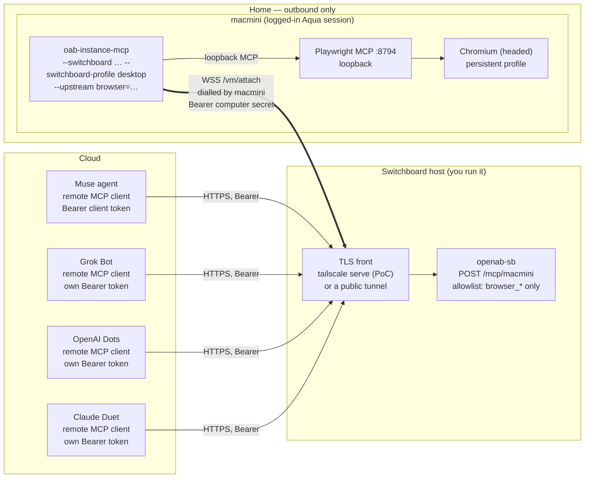

# Use case — Muse browses from a home residential IP, not its built-in browser

An agent like Muse has a built-in browser. That browser runs in the agent's own environment, so
every site sees that environment's network address, and it holds none of your logins. For some
tasks that is the wrong browser: the site wants a residential address, or the task needs a
session you already have at home.

`openab-sb` is what lets Muse use the browser on a computer at home instead — a Mac mini, for
instance — even though the two cannot reach each other:

```
Muse (cloud agent)  ──HTTPS + Bearer──►  openab-sb  ◄──WSS (home dials out)──  macmini
                                         switchboard                            oab-instance-mcp
                                                                                + Playwright MCP
                                                                                + Chromium
```

This page is a reference for that one use case, not a requirement. It builds on
[`README.md`](../README.md), [`SOUTHBOUND-CONTRACT.md`](SOUTHBOUND-CONTRACT.md) and
[`adr/multi-computer.md`](adr/multi-computer.md).

## The problem

|  | Muse's built-in browser | The browser on the home computer |
|---|---|---|
| Network address seen by sites | Muse's environment | Your home **residential IP** |
| Cookies and logged-in sessions | none | the home browser profile's |
| Reachable from Muse | yes | **no** — no inbound port, behind NAT |

The row that blocks the use case is the last one. The home computer can only dial out, and Muse
cannot enter the home network.

## Where sb comes in

Both sides can dial out, so neither needs to listen:

- the home computer dials the switchboard (southbound, `/vm/attach`) and serves MCP on that
  socket;
- Muse calls the switchboard (northbound, `POST /mcp/<computer>`) like any remote MCP server;
- the switchboard relays between them, and its per-caller allowlist decides which tools Muse may
  use — here, the browser tools only.

A tool call is then executed on the home computer, so the browser it drives leaves from the home
IP and carries that profile's cookies and sessions. That is the benefit, and also the risk — see
[Trust and risk](#trust-and-risk).

## Roles

Muse appears in two different roles in this repository. Do not mix them up:

| Role | What it is | Direction | Where it is configured |
|---|---|---|---|
| **Computer** (`muse-vm`) | A Muse Secure VM that is *controlled*, running `sb_daemon.py` | dials `/vm/attach` | `[[computer]]` |
| **Caller** (this page) | Muse the agent that *controls* a computer | calls `POST /mcp/<computer>` | `[[client]]` |

This page is about Muse as a **caller** and the Mac mini as the **computer**.

## Components

> Each cloud agent below is a separate caller with its own `[[client]]` token and allowlist. Muse is the worked example; **Grok Bot**, **OpenAI Dots** and **Claude Duet** are drawn the same way, but this page has not checked that each can add a remote MCP server with a custom `Authorization` header.



| Piece | Runs on | Job |
|---|---|---|
| Muse, Grok Bot, OpenAI Dots, Claude Duet | cloud | MCP clients, one `[[client]]` each. Needs to add a remote MCP server by URL with an `Authorization` header |
| TLS front | switchboard host | Terminates TLS. The PoC uses `tailscale serve` (tailnet only), so Muse must reach the tailnet; a public tunnel such as `cloudflared` is the alternative when it cannot |
| `openab-sb` | switchboard host | Authenticates, picks the computer from the path, applies the per-caller tool allowlist, relays |
| `oab-instance-mcp` | macmini | Dials the switchboard, serves tools on that socket under one profile |
| Playwright MCP | macmini | Loopback MCP server driving the browser (`poc/pw-mcp` in OpenAB Computer) |
| Chromium | macmini | The browser, with the persistent profile |

## Call flow

1. `oab-instance-mcp` dials `wss://<switchboard>/vm/attach` with the computer secret. The
   switchboard picks the slot from the secret and sends `initialize`.
2. Muse calls `POST https://<switchboard>/mcp/macmini` with its client token.
3. The switchboard resolves, in order, the token, then the computer, then the tool. A tool
   outside the allowlist is absent from `tools/list` and refused on `tools/call`.
4. Allowed calls are relayed down the computer's socket. `oab-instance-mcp` filters again by
   its own profile and forwards `browser_*` calls to the Playwright MCP upstream on loopback.
5. Chromium acts from the home network and replies travel back the same way.

While the Mac is offline, Muse gets the tool error "the VM is not connected" and still finds
the switchboard (`/healthz` is 200).

## Setup

### 1. Switchboard

```sh
openab-sb gen-secret     # once for the computer  → secret (macmini) + verifier
openab-sb gen-secret     # once for the caller    → token  (Muse)    + verifier
```

`openab-sb.toml`:

```toml
[[computer]]
name = "macmini"
secret_sha256 = "sha256:…"            # verifier of the macmini secret

[[client]]
name = "muse"
token_sha256 = "sha256:…"             # verifier of Muse's token
default_computer = "macmini"
computers = { macmini = [
  "sys_info",
  "browser_navigate", "browser_navigate_back", "browser_snapshot", "browser_find",
  "browser_click", "browser_type", "browser_fill_form", "browser_press_key",
  "browser_hover", "browser_select_option", "browser_wait_for", "browser_tabs",
  "browser_take_screenshot", "browser_console_messages", "browser_resize",
] }
max_inflight = 2
```

The list above is the OpenAB Computer `desktop` browser set
(`ToolProfile.desktopBrowserTools`) plus `sys_info`. Trim it further if the task allows.
Deliberately **absent**: `mouse`, `key`, `osascript`, `exec*`, `screenshot` of the whole
desktop. Then `openab-sb check -c openab-sb.toml` and `openab-sb serve -c openab-sb.toml`.
Put TLS in front — see [Exposing the switchboard](#exposing-the-switchboard).

### 2. Mac mini

Install the Playwright MCP upstream (`poc/pw-mcp/install.sh` in OpenAB Computer), then give
`oab-instance-mcp` the switchboard URL, the computer secret and the upstream:

```sh
oab-instance-mcp --token-file ~/.config/oab-instance-mcp/token \
  --upstream browser=http://127.0.0.1:8794/mcp \
  --switchboard wss://<switchboard>/vm/attach \
  --switchboard-secret-file ~/.config/oab-instance-mcp/switchboard.secret \
  --switchboard-profile desktop
```

Why `desktop`: `observe` serves `sys_info` and `screenshot` only, with no browser tools.
`owner` adds shell and arbitrary-JavaScript browser tools. `desktop` is the smallest profile
that carries the 15 browser tools. It *also* carries `mouse`, `key` and `osascript` on the
computer, which is why the switchboard allowlist above is what keeps Muse to the browser.

With the packaged installer, put the URL, secret and profile in
`~/.config/oab-instance-mcp/switchboard.{url,secret,profile}` and re-run the installer.

### 3. Muse

Muse does not take a pasted URL as a native tool. It reaches a remote MCP server through
Muse-side CLI code run with `muse.exec`, built from its custom-connector scaffold. Register the
switchboard once through Muse's secure API-access flow (the owner does this):

- bare `api_hosts`: the switchboard host. Scheme, credential placement and hosts cannot be
  changed afterwards; a mistake means a new link and re-entering the key. Moving the switchboard
  to another host therefore means a **new** connection.
- credential: the Muse client token, as a bearer header. The model sees only a surrogate; the
  runtime swaps in the real token on an approved request to a registered host.

Client notes (reported by Muse on 2026-10-26, see [Muse results](#muse-results)):

- The stock template does `initialize`, then `tools/list` / `tools/call`, over Streamable HTTP.
  The switchboard answers `initialize` itself, so this should work. A JSON response without SSE
  is accepted.
- The stock template refuses any endpoint port other than 443, and fails a call after 45 s of
  silence. `openab-sb` times most tools out at 60 s. Serve the switchboard on 443, or use a client
  that allows the port and a timeout above 60 s.
- The template's `ALLOWED_TOOLS` is an exact-name list, so a tool the server adds later stays
  blocked until it is reviewed.
- Port 443 is necessary but **not sufficient** for a tailnet-only host. With Muse's default egress
  proxy the stock template fails in about 0.4 s ("MCP request did not complete"), because that
  proxy cannot reach a tailnet-only name. With the proxy environment pointed at Muse's tailnet
  proxy (the egress proxy host, port 3130) the stock template works unchanged: protocol
  2025-06-18, server `openab-sb 0.2.0`.

### 4. Verify

```sh
# 1. computer attached and ready
curl -s -H "Authorization: Bearer $MUSE_TOKEN" https://<switchboard>/readyz/macmini -o /dev/null -w '%{http_code}\n'   # 200

# 2. what Muse can see: expect sys_info, vm_status (always present) and the allowlisted tools,
#    and no mouse/key/exec
curl -s -H "Authorization: Bearer $MUSE_TOKEN" -H 'Content-Type: application/json' \
  -H 'Accept: application/json, text/event-stream' \
  -d '{"jsonrpc":"2.0","id":1,"method":"tools/list"}' https://<switchboard>/mcp/macmini

# 3. a forbidden tool is refused by the switchboard policy
#    tools/call name=mouse  → text result "tool mouse is not allowed for muse on macmini …"
```

Then have Muse call `browser_navigate` to an IP-echo page and compare with your home
address, and open a site the profile is logged in to.

## Exposing the switchboard

`openab-sb` binds loopback and needs TLS in front.

- Muse **inside** your tailnet (**the PoC**): `tailscale serve --bg --https=8445 http://127.0.0.1:8796`, giving `https://<host>.<tailnet>.ts.net:8445/mcp/<computer>`. Tailnet only, no Funnel. Muse reaches it as a client-only tailnet member through its runtime HTTP CONNECT proxy (see [Muse results](#muse-results)), so no public front is needed.
- Muse **outside** your tailnet: a public tunnel such as `cloudflared` (not used in the PoC). The bearer tokens are then the only gate, so keep the generated 256-bit
  tokens, rotate with `SIGHUP`, and keep the allowlist narrow.
- If Muse only reaches approved addresses, that address is the switchboard's front.

## Trust and risk

- **The browser profile is lent whole.** Muse can act as any account logged in to that
  Chromium profile. Use a **dedicated profile** logged in only to what the task needs, not
  your daily browser.
- **The allowlist is policy, not isolation.** It narrows what Muse may *call*; it does not
  narrow the browser. The computer is still an unrestricted desktop user, and `mouse`/`key`/
  `osascript` are hidden from Muse by the allowlist only. The computer's profile remains the
  ceiling and the caller gets the intersection.
- **Prompt injection.** Page text and screenshots go into Muse's context. A hostile page can
  try to steer an agent that holds your sessions. Treat browser output as untrusted.
- **Network reach.** The browser reaches whatever the Mac reaches, including localhost and the
  home LAN. Put the Mac on a network segment you are willing to expose, or use a dedicated
  machine.
- **The switchboard holds both sides' credentials.** Run it only on a host you trust. It
  stores only `sha256:` verifiers.
- **Public exposure.** With a public tunnel there is no tailnet identity check, only tokens.

## Limits of this reference

- **macOS only today for `--switchboard`.** In OpenAB Computer `main`, `--switchboard` exists in
  the Swift daemon. The Linux Rust hands node (`poc/reverse-attach-linux`) has no switchboard
  mode, so a Raspberry Pi or mini PC would need a daemon that follows
  [`SOUTHBOUND-CONTRACT.md`](SOUTHBOUND-CONTRACT.md) (see `examples/muse-daemon/sb_daemon.py`)
  and its own browser tooling.
- **No browser-only profile yet.** `desktop` still includes GUI tools; OpenAB Computer tracks a
  narrower browser tier in its #45. Until then the switchboard allowlist is the control.
- **One socket per computer.** A second daemon with the same secret evicts the first (`4002`).
- **Verified on the PoC, with one caveat.** The path from Muse to the computer, and a browser call that
  leaves from the Mac mini's network, were exercised on 2026-10-26 (see
  [Muse results](#muse-results)). The returned address belongs to the same ASN as the Mac mini's own
  egress and differs from Muse's. "Residential" in the strict sense is an inference from a consumer
  ISP, not a proof.
- **Muse's built-in browser is described from the use case, not measured.** The comparison in
  [The problem](#the-problem) states the motivation; this page did not test what address or
  sessions Muse's own browser presents.
- **Public front untested.** Only the tailnet route was exercised. Whether Muse accepts a
  Cloudflare certificate was not tested, and a public host would need a new registered connection.

## Muse results

Reported by Muse on 2026-10-26, from its connector docs and a live check against the PoC.

| Question | Answer |
|---|---|
| Remote MCP with a bearer header | Yes, via CLI connector code (`muse.exec`), not a native tool. Streamable HTTP, protocol 2025-11-25 / 2025-06-18 / 2025-03-26 |
| Reach the switchboard | Muse's VM is a **client-only** tailnet member (enrolled 2026-10-03). No TUN: tailnet traffic goes through the runtime HTTP CONNECT proxy, TCP only. No `tailscale serve` or inbound |
| Hostname allowlist | Authenticated calls are limited to registered `api_hosts`. Only the owner can add one; the model cannot |
| Non-443 port | Works with a bespoke client (`:8445`, 0.24 s for `tools/list`); the stock template refuses it |
| TLS | `*.ts.net` certificate accepted with default verification. A Cloudflare certificate was **not** tested |
| Images | `browser_take_screenshot` (fullPage) about 920 KB in 1.9 s; `screenshot` at scale 2 about 951 KB in 2.9 s; both intact. Muse's own maximum is unknown |
| Timeouts | Stock template: 45 s, no retry. Bespoke client: 120 s |
| Tool count | 11 listed: `sys_info`, `screenshot`, 8 browser tools, and `vm_status` (always present). No `mouse`, `key`, `exec`, `browser_evaluate` |
| Errors | `isError` and JSON-RPC errors surface as text and do not drop the server. `mouse` returned a policy denial, not "unknown tool" |
| Token | Held in the secure credentials store; the model sees a surrogate. Muse cannot audit its own server-side logs |
| Untrusted output | Treated as untrusted data, including home-browser page content |

The computer reported `accessibility=false` in `sys_info`, so `mouse` and `key` would fail on
permissions there even if policy allowed them.

### Re-run against the switchboard on p1 (2026-10-26)

| Step | Result |
|---|---|
| Stock template, `https://p1.<tailnet>.ts.net/mcp/macmini`, port 443 | Works unchanged **through the tailnet proxy**; fails through the default egress proxy (see above) |
| `tools/list` | 11 tools: `sys_info`, `screenshot`, 8 browser tools, `vm_status`. No `mouse`, `key`, `exec`, `browser_evaluate` |
| `sys_info` / `vm_status` | macOS 15.7.4, Apple M4, Screen Recording on, Full Disk Access on, Accessibility off; `macmini` attached and ready, max 8 in flight |
| `mouse` | Refused by switchboard policy as a normal tool result; later calls kept working |
| IP-echo page | One address returned, **different from Muse's own egress address**. The address itself was withheld on purpose. Looked up by Muse: AS18616, Natural Wireless, LLC; hosting, mobile and proxy flags all false |
| Screenshots | `screenshot` (whole desktop): 2.7 s, JPEG 1920x1080, about 165 KB, intact. `browser_take_screenshot` (viewport): 0.8 s, PNG about 7.5 KB, intact |
| Persistent profile | A site the profile is signed in to loaded its signed-in interface, with no login wall or captcha. No account details were recorded |
| Latency | list-tools 0.8 to 1.1 s; `sys_info` 1.1 s; `browser_navigate` 2.7 s (IP-echo), 10.9 s (signed-in site); first manual `initialize` through the proxy 17 s. Nothing over 45 s |

The Mac mini's own egress, looked up separately by the operator, is the same network: AS18616, Natural
Wireless, LLC, a fixed-wireless ISP. So the browser call leaves from the Mac mini's network, and that
network is consumer ISP egress rather than a cloud or datacenter one. An ASN and organisation do not
prove a connection is residential in the strictest sense.

## Operating notes (from Muse, 2026-10-26)

- **Tailnet proxy.** A client for a tailnet-only host has to use Muse's tailnet proxy (the egress proxy
  host, port 3130). The connector descriptor has no proxy setting, so Muse added a small wrapper
  (`run-p1`) next to the stock client that derives the proxy from `HTTPS_PROXY`, swaps the port to 3130
  and runs the stock client unchanged. If the runtime stops offering that proxy, the wrapper fails
  the same way as the default proxy did.
- **"Always allow" is a network rule, not a credential scope.** The site approval created an allow
  rule for `tailb836bb.ts.net` and `*.tailb836bb.ts.net` on ports 80 and 443. It lets Muse's sandbox
  connect; it does not grant a token. The credential is registered for the single host
  `p1.<tailnet>.ts.net` and is only substituted for that host. The rule can be narrowed in the Muse app
  under Settings > Permissions; the agent itself cannot change it.
- **Key rotation.** Rotating the Muse token on the switchboard does not need a new host registration:
  reconnect the existing connection through the secure API-access flow with the same provider, host,
  scheme and placement, and enter the new token. Hosts, scheme and placement cannot be changed on a
  reconnect. The old stored token stops working as soon as the switchboard's verifier changes, and
  nothing checks the new key at setup, so the first real call is the proof.
- **Retiring a connection.** Disconnecting a connector in Muse removes its stored token from Muse, but
  does **not** revoke it on the switchboard. If two connections held the same token value, revoking
  it means rotating the token on the switchboard and reconnecting the one you keep.
